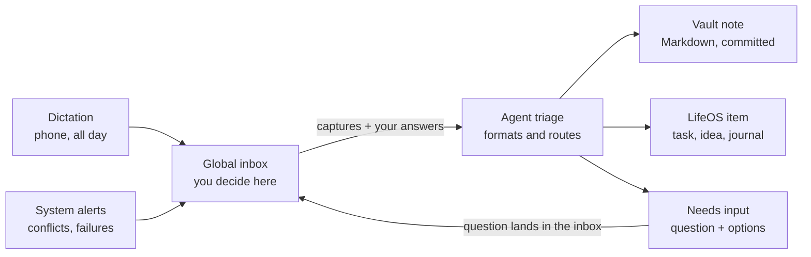

# Notes System Plan: Paperless, Sync, and a Frozen Notes Spec

Nov 12, 2026 · Chris Delaney

## Linking Paperless to LifeOS

Paperless can link into LifeOS through its REST API, which covers documents, tags, custom fields, full-text search, and uploads. The principle: Paperless owns the files and OCR, LifeOS owns the meaning and relationships, and links connect them. Don't copy documents into LifeOS.

Three levels of integration, simplest first:

1. **Reference by ID.** LifeOS stores a link like `paperless:1234` on any goal, project, or journal entry. The Journal service's polymorphic subject references already support this: a Paperless document is one more subject type. LifeOS fetches title, thumbnail, and preview on demand.
2. **Expose search to the agent.** Add a LifeOS MCP tool that wraps Paperless search, such as `find_documents(query, tags, date_range)`. The same agent that knows your projects can then answer "find the dishwasher warranty." Biggest payoff for the least work.
3. **Push events into LifeOS.** Recent Paperless-ngx versions have workflows that trigger on new documents, including webhook actions. A new scan lands in the LifeOS inbox for triage ("looks like a tax document; attach to 2026 taxes?"). Optionally write the LifeOS ID back into a Paperless custom field so the link exists in both places.

## Syncthing vs. OneDrive

For a Markdown vault that LifeOS indexes, Syncthing fits better, and Git should sit alongside it for history.

|  | Syncthing | OneDrive |
| --- | --- | --- |
| LifeOS ingestion | Server sees a real local folder; ingestion is file watching | Needs Graph API, or fights Files On-Demand placeholders |
| Android | True two-way sync of any folder | No arbitrary two-way folder sync without a third-party helper |
| Availability | Needs devices online together, unless one is always on | Cloud copy always available |
| Web access | None | Yes |
| Version history | Configure it yourself | Built in |
| Privacy | No cloud copy, no account, no quotas | Stored with Microsoft |

**Recommended setup:** Syncthing for device sync, an always-on machine as the hub, and a Git repo for history. AI writes become commits you can diff and revert, which gives provenance and auditability for free.

**Update (2026-11-12): stay on Obsidian Sync.** The vault (`C:\Users\csdel\Vaults\Chris2.0`) already syncs across PICARD, Mercury, Venus and Jupiter with Obsidian Sync, which works on Android and keeps version history. Moving to Syncthing would add work without fixing a problem. Git still sits alongside, on PICARD only; Obsidian Sync skips dot-folders, so `.git` stays local. PICARD is the hub: agents work on its copy of the vault.

## The fix: decide once, freeze it, enforce it with tooling

The resistance to Obsidian is option paralysis, not the tool. The answer is a written spec that makes the decisions once, plus automation that enforces it, so the knobs stop being your problem.

### 1. Write a one-page Notes Spec and freeze it

- **Note types, 5 max:** reference, knowledge, source, decision, project-note
- **Frontmatter:** one schema per type, required fields only
- **Folders:** flat — `inbox/` plus one folder per type
- **Linking:** wiki-links in the body, plus a `related:` field for LifeOS IDs
- **Tags:** a small controlled list
- **Freeze rule:** no spec changes for 90 days; changes only at a quarterly review, recorded in a changelog

### 2. Let AI do the formatting

Capture messily by voice, paste, or quick text. An agent with the spec loaded applies the template, frontmatter, summary, and suggested links, then files the note. You review and approve. This gets Obsidian's polished end state without the friction. Package the spec as a Claude skill so every Claude surface produces conforming notes.

### 3. Enforce the spec deterministically

A small validator checks each note's frontmatter against a JSON Schema for its type. LifeOS ingestion routes non-conforming notes to a "needs fixing" queue instead of accepting them silently. This is the process enforcement Obsidian lacks, and it follows the "deterministic before probabilistic" principle.

### 4. Treat the editor as a locked-down window

- **Option A:** keep Obsidian for its rendering, with a near-zero plugin rule in the spec and its config committed to Git so drift is visible.
- **Option B:** switch to a deliberately opinionated editor with few settings, such as iA Writer or Typora (verify current Windows and Android support).

Either way, the editor only reads and makes light edits. Structure comes from the spec and the agent, so the editor can be swapped later without changing the vault.

## Dictation pipeline and global inbox

Dictate all day; an agent files each capture, and anything needing a decision comes back through one place. The global inbox holds everything that needs your input or decision, from any source.

Clear captures are filed without you; anything uncertain, and any system problem, returns to the inbox as a question.

### Pipeline rules

- **Keep the raw transcript.** Store it untouched and link each formatted note back to it.
- **Confidence threshold.** Clear items are filed automatically; ambiguous ones become "needs input" items.
- **Route by kind.** Tasks and ideas go to LifeOS state objects. Reflections and journal entries, reference, knowledge, sources and project notes go to the vault ([Notes Spec](notes-spec.md) §1; changed 2026-11-12, when reflections moved to the vault).
- **Create, don't rewrite.** The agent adds new notes and appended sections; restructuring hand-edited notes needs review.
- **Daily digest.** A short "here's what I filed today" summary for spot-checking.

### Git on the hub

- The agent commits once per processed item, with the inbox item ID in the message.
- A scheduled script commits manual edits from phone and desktop.
- The repo lives only on the hub; add `.git` to `.stignore` so devices never see it.
- No force-pushes or history rewrites; push to an offsite remote as backup.

### Global inbox design

- **Answerable in one step.** Each item carries the question, linked context, two to four options, and the agent's recommendation. Your answer flows back to the agent that asked.
- **Blocking vs. non-blocking.** Low-stakes questions proceed with the recommended default after a timeout, and the inbox records that it did.
- **Noise control.** Dedupe repeated questions, batch non-urgent items into a daily review, and give items priority and expiry.
- **System problems as items.** A hub script turns `.sync-conflict` files, failed spec validations, and failed Git pushes into inbox items.
- **Provenance.** Each item records its source, why it was created, and what happened after you answered.

### Minimal first version

1. Dictate into the inbox.
2. The agent files clear notes into the vault and commits them.
3. Anything uncertain returns to the inbox as a "needs input" item.

Live with that for a few weeks before designing the rest.

## Decisions (Chris)

- **2026-11-12: reflections live in the vault (option A).** Chris dictates his daily reflections; an agent summarizes and formats each into a vault note in the Notes Spec's format, and the LifeOS review links to it. This replaces SuperJournal as the home of review answers ([reviews plan](pilot/reviews-plan.md) §4). He still uses SuperJournal for other things.
- **2026-11-12: the notes system comes before the rest of the roadmap's daily command center** (TODAY-1, TODAY-2, monthly reviews), because it also gives reviews their answers.
- **2026-11-12: one of the first jobs after the spec is a complete cleanup of the vault,** done by an agent, so the vault is standardised as a baseline before the pipeline starts writing into it (N3).
- **2026-11-12, Chris's answers on the draft spec:**
  - **Folders by type,** and today's folders retired as their notes move. "This is especially not needed if my AI agents will organize and link stuff for me." Claude's reorganization suggestions stand.
  - **Zero task objects in the vault.** "Most tasks I figure will be deleted out of Obsidian."
  - **Large videos in a standard OneDrive place, linked from notes.** He'll have many more. Adding one mustn't need hand-linking (spec §5).
  - **Generated maps (MoC):** for instance one for all the daily, weekly and monthly reflections with past months and years folded, per note type or as he defines them, plus a central dashboard to drill down from, all managed by agents (spec §6).
  - **The spec is frozen only after he has seen the reorganized vault,** so the first version is reached by iterating (N3).

## The vault today (surveyed 2026-11-12)

- 172 notes, about 56,000 words, and 4.6 GB, of which about 3.6 GB is course videos.
- Folders mix two numbering schemes (`00 - Inbox`, `10 - Projects`, `200-Areas`, `300-Resources`, `98 - Attachments`), clippings sit in two places, and `Tags/` and `10 - Projects/Untitled/` are empty. The vault's own `CLAUDE.md` describes folder names that no longer match.
- 93 notes have no front matter, 42 have fewer than 15 words, and 35 link targets don't resolve.
- 67 daily logs in `300-Resources/Journals/`, with a routine checklist (now LifeOS habits) and a sober-streak field (now the Food Log's).
- 154 open checkboxes, mostly in project notes, behind a Tasks-plugin dashboard.
- 13 community plugins. Make.md leaves `.mdc`, `.mdb` and `.space` files; `.obsidian` holds about 80 `workspace-<device>-N.json` files.
- Not under Git. The vault's `CLAUDE.md` already defines APPEND-ONLY and DIRECT-MODIFY modes for agents, which the spec keeps.

## Phases

| Phase | What | Done when |
|---|---|---|
| **N0** | This plan | Committed |
| **N1** | The [Notes Spec](notes-spec.md): drafted, then revised in each N3 round | Frozen in N4 |
| **N2** | Baseline: a full snapshot of the live vault, and a working copy to reorganize (below) | The copy opens in Obsidian as its own vault, with Sync off |
| **N3** | The reorganization, on the copy, in rounds (below): the manifest and the script that applies it, the map generator and `Home.md`, the validator. Chris browses each round in Obsidian; the spec changes with his feedback | Chris is happy with the reorganized copy |
| **N4** | Freeze and cut over: the spec frozen and moved into the vault, the manifest re-run on the live vault, Git started there, the videos moved to `Vault Media`, the dropped plugins removed | The live vault matches the copy and the validator passes |
| **N5** | The formatter skill (the spec packaged so every Claude surface writes conforming notes) and the media sweep | A dictated sample becomes a valid note of each type, and a dropped video gets its note |
| **N6** | The minimal dictation pipeline: dictate, the agent files clear notes and commits, anything unclear comes back as a needs-input item | A week of real use |
| **N7** | LifeOS agent writes at the `capture` level (agent-access plan Phase 2), so the agent can mark a capture handled, file Tasks and Ideas, and link a reflection to its review | The agent-access plan's Phase 2 tests |
| **N8** | Reviews R5: the review links to its reflection note, and the page shows its summary and an "Open in Obsidian" link | A daily and a weekly review answered by dictation |
| **N9** | Paperless search in `/mcp` | An agent finds a document by asking |

N2 to N4 need nothing from LifeOS. N6 can start before N7 by filing only into the vault.

### N2 and N3: reorganizing a copy

An agent in a Claude Code session on PICARD. Chris keeps using the live vault as usual the whole time.

**The copy:**

1. A full snapshot of the live vault first: a zip in `C:\Users\csdel\Vaults\_snapshots\`, checked by opening it.
2. The working copy is `C:\Users\csdel\Vaults\Chris2.0 reorg`, without the large videos (they're only linked).
3. **Obsidian Sync must stay off in the copy,** or the reorganization could sync into the live vault and every device. Before the copy is first opened, the `sync` core plugin is switched off in its `.obsidian/core-plugins.json`, and Chris doesn't connect it to a remote vault.
4. Git starts in the copy, with a first commit of it as found, so every round is a diff Chris can read and undo.

**What a round does:**

1. **A manifest:** every note with its type, new folder and name, front matter changes, merges and archivals, as a file the apply script reads. The agent's uncertain calls are marked in it.
2. **An apply script** that turns the copy into the reorganized vault from the manifest, rewriting every link to a moved note. Reorganizing by script, not by hand, is what lets N4 re-run it on the live vault, which has moved on in the meantime.
3. **Reflections:** the 67 daily logs become `reflection` notes, `kind: daily`, with their writing untouched; the routine checklists and sober-streak fields go, since LifeOS keeps both.
4. **Tasks:** checkboxes are removed. Git keeps the old text, and a list in `99 System/` shows what was removed from each note, so Chris can carry any he wants into LifeOS.
5. **Projects** are linked to their LifeOS items by URN, and the ones with no match are listed.
6. **Maps and `Home.md`** generated from the starting definitions (spec §6).
7. **The validator** runs, and the unresolved links are fixed or listed.
8. **Nothing is deleted.** Notes leave through `98 Archive/`.
9. Chris opens the copy in Obsidian ("Open folder as vault") and says what to change. The spec and the manifest change, and the next round starts from the snapshot again.

The tools (apply script, map generator, validator) are Python, kept in the vault under `99 System/tools/`, so they're versioned with it.

### Round 1 (2026-11-12)

- **Snapshot:** `C:\Users\csdel\Vaults\_snapshots\Chris2.0 2026-11-12 1014.zip` (628 files, 4.84 GB, every member read back), with an inventory of each file's size, date and CRC beside it. `snapshot.py compare` against it showed the live vault unchanged after the round.
- **The copy** left out 14 videos (4.8 GB); `99 System/Media to move.md` lists each with its `Vault Media` path. Sync is off in its `core-plugins.json`. Git: `0c9e876` is the vault as found, `d7957da` the round.
- **Result:** 169 notes moved to the type folders (54 of them to `98 Archive`), 331 checkboxes taken out, 22 links rewritten, the maps and `Home.md` generated. The validator fails only the 4 projects with no LifeOS item, and warns about 3 notes holding secrets (by location in the round report) and 5 links to notes that were never written.
- **The manifest** is written by `99 System/reorg/build_manifest.py`, which holds every call, the summaries an agent wrote for the daily reflections, and the routine-checklist items. Change the calls there, not in the YAML.
- **A new round** starts from the as-found commit; `99 System/tools/README.md` has the steps. Git writes every file with today's date, so `snapshot.py restore-times` puts the dates back before the apply.
- **For N4:** the copy's Git history holds the 3 secrets, so it stays on PICARD, and they come out of the live notes before Git starts there. Plugin settings that name old folders (Iconize, Make.md) were left as they are.

## Status

- [x] N0 — This plan
- [ ] N1 — Notes Spec (draft v0.2, 2026-11-12; revised in each N3 round)
- [ ] N2 — Snapshot and a working copy (both made 2026-11-12; done once Chris has opened the copy in Obsidian)
- [ ] N3 — Reorganize the copy, in rounds (round 1 applied 2026-11-12; waiting on Chris's review)
- [ ] N4 — Freeze the spec and cut over
- [ ] N5 — Formatter skill and media sweep
- [ ] N6 — Minimal dictation pipeline
- [ ] N7 — LifeOS agent writes at `capture`
- [ ] N8 — Reviews R5: reflections linked to reviews
- [ ] N9 — Paperless search in `/mcp`

## Later

- **Videos that play on the phone.** The `file:///` embeds play only on PCs that sync OneDrive. OneDrive share links, made by the agent through Microsoft Graph, would play anywhere.
