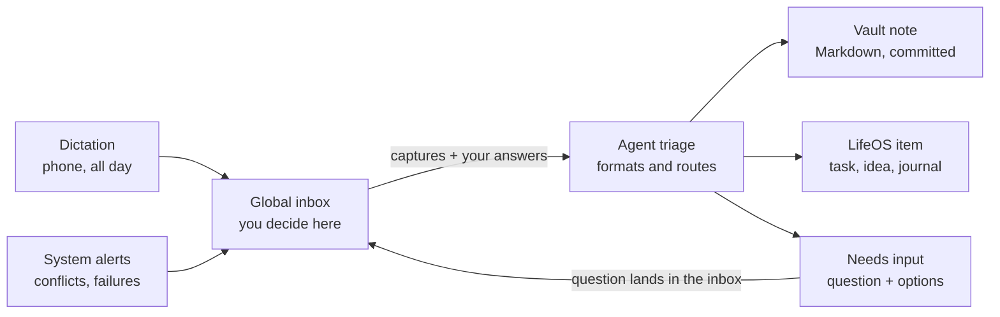

# Notes System Plan: Paperless, Sync, and a Frozen Notes Spec

Nov 12, 2026 · Chris Delaney

## Linking Paperless to LifeOS

Paperless can link into LifeOS through its REST API, which covers documents, tags, custom fields, full-text search, and uploads. The principle: Paperless owns the files and OCR, LifeOS owns the meaning and relationships, and links connect them. Don't copy documents into LifeOS.

Three levels of integration, simplest first:

1. **Reference by ID.** LifeOS stores a link like `paperless:1234` on any goal, project, or journal entry. The Journal service's polymorphic subject references already support this: a Paperless document is one more subject type. LifeOS fetches title, thumbnail, and preview on demand.
2. **Expose search to the agent.** Add a LifeOS MCP tool that wraps Paperless search, such as `find_documents(query, tags, date_range)`. The same agent that knows your projects can then answer "find the dishwasher warranty." Biggest payoff for the least work.
3. **Push events into LifeOS.** Recent Paperless-ngx versions have workflows that trigger on new documents, including webhook actions. A new scan lands in the LifeOS inbox for triage ("looks like a tax document; attach to 2026 taxes?"). Optionally write the LifeOS ID back into a Paperless custom field so the link exists in both places.

## Syncthing vs. OneDrive

For a Markdown vault that LifeOS indexes, Syncthing fits better, and Git should sit alongside it for history.

|  | Syncthing | OneDrive |
| --- | --- | --- |
| LifeOS ingestion | Server sees a real local folder; ingestion is file watching | Needs Graph API, or fights Files On-Demand placeholders |
| Android | True two-way sync of any folder | No arbitrary two-way folder sync without a third-party helper |
| Availability | Needs devices online together, unless one is always on | Cloud copy always available |
| Web access | None | Yes |
| Version history | Configure it yourself | Built in |
| Privacy | No cloud copy, no account, no quotas | Stored with Microsoft |

**Recommended setup:** Syncthing for device sync, an always-on machine as the hub, and a Git repo for history. AI writes become commits you can diff and revert, which gives provenance and auditability for free.

## The fix: decide once, freeze it, enforce it with tooling

The resistance to Obsidian is option paralysis, not the tool. The answer is a written spec that makes the decisions once, plus automation that enforces it, so the knobs stop being your problem.

### 1. Write a one-page Notes Spec and freeze it

- **Note types, 5 max:** reference, knowledge, source, decision, project-note
- **Frontmatter:** one schema per type, required fields only
- **Folders:** flat — `inbox/` plus one folder per type
- **Linking:** wiki-links in the body, plus a `related:` field for LifeOS IDs
- **Tags:** a small controlled list
- **Freeze rule:** no spec changes for 90 days; changes only at a quarterly review, recorded in a changelog

### 2. Let AI do the formatting

Capture messily by voice, paste, or quick text. An agent with the spec loaded applies the template, frontmatter, summary, and suggested links, then files the note. You review and approve. This gets Obsidian's polished end state without the friction. Package the spec as a Claude skill so every Claude surface produces conforming notes.

### 3. Enforce the spec deterministically

A small validator checks each note's frontmatter against a JSON Schema for its type. LifeOS ingestion routes non-conforming notes to a "needs fixing" queue instead of accepting them silently. This is the process enforcement Obsidian lacks, and it follows the "deterministic before probabilistic" principle.

### 4. Treat the editor as a locked-down window

- **Option A:** keep Obsidian for its rendering, with a near-zero plugin rule in the spec and its config committed to Git so drift is visible.
- **Option B:** switch to a deliberately opinionated editor with few settings, such as iA Writer or Typora (verify current Windows and Android support).

Either way, the editor only reads and makes light edits. Structure comes from the spec and the agent, so the editor can be swapped later without changing the vault.

## Dictation pipeline and global inbox

Dictate all day; an agent files each capture, and anything needing a decision comes back through one place. The global inbox holds everything that needs your input or decision, from any source.

Clear captures are filed without you; anything uncertain, and any system problem, returns to the inbox as a question.

### Pipeline rules

- **Keep the raw transcript.** Store it untouched and link each formatted note back to it.
- **Confidence threshold.** Clear items are filed automatically; ambiguous ones become "needs input" items.
- **Route by kind.** Tasks, ideas, and journal entries go to LifeOS state objects; only reference and knowledge go to the vault.
- **Create, don't rewrite.** The agent adds new notes and appended sections; restructuring hand-edited notes needs review.
- **Daily digest.** A short "here's what I filed today" summary for spot-checking.

### Git on the hub

- The agent commits once per processed item, with the inbox item ID in the message.
- A scheduled script commits manual edits from phone and desktop.
- The repo lives only on the hub; add `.git` to `.stignore` so devices never see it.
- No force-pushes or history rewrites; push to an offsite remote as backup.

### Global inbox design

- **Answerable in one step.** Each item carries the question, linked context, two to four options, and the agent's recommendation. Your answer flows back to the agent that asked.
- **Blocking vs. non-blocking.** Low-stakes questions proceed with the recommended default after a timeout, and the inbox records that it did.
- **Noise control.** Dedupe repeated questions, batch non-urgent items into a daily review, and give items priority and expiry.
- **System problems as items.** A hub script turns `.sync-conflict` files, failed spec validations, and failed Git pushes into inbox items.
- **Provenance.** Each item records its source, why it was created, and what happened after you answered.

### Minimal first version

1. Dictate into the inbox.
2. The agent files clear notes into the vault and commits them.
3. Anything uncertain returns to the inbox as a "needs input" item.

Live with that for a few weeks before designing the rest.

## Next steps

- [ ] Draft the Notes Spec: note types, frontmatter schemas, templates, folder layout, linking rules, freeze rule
- [ ] Turn the spec into a note-formatter Claude skill
- [ ] Build the minimal dictation pipeline (dictate, file, needs-input)
- [ ] Add a Paperless search tool to the LifeOS MCP server
