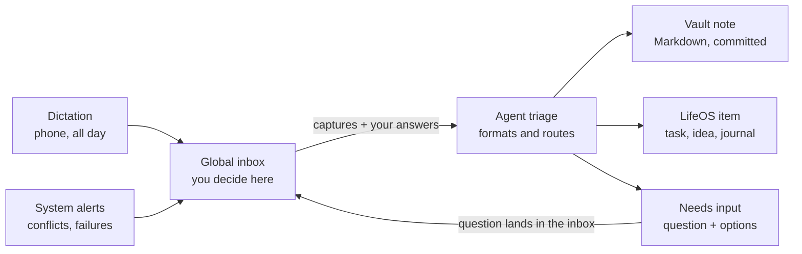

# Notes System Plan: Paperless, Sync, and a Frozen Notes Spec

Nov 12, 2026 · Chris Delaney

## Linking Paperless to LifeOS

Paperless can link into LifeOS through its REST API, which covers documents, tags, custom fields, full-text search, and uploads. The principle: Paperless owns the files and OCR, LifeOS owns the meaning and relationships, and links connect them. Don't copy documents into LifeOS.

Three levels of integration, simplest first:

1. **Reference by ID.** LifeOS stores a link like `paperless:1234` on any goal, project, or journal entry. The Journal service's polymorphic subject references already support this: a Paperless document is one more subject type. LifeOS fetches title, thumbnail, and preview on demand.
2. **Expose search to the agent.** Add a LifeOS MCP tool that wraps Paperless search, such as `find_documents(query, tags, date_range)`. The same agent that knows your projects can then answer "find the dishwasher warranty." Biggest payoff for the least work.
3. **Push events into LifeOS.** Recent Paperless-ngx versions have workflows that trigger on new documents, including webhook actions. A new scan lands in the LifeOS inbox for triage ("looks like a tax document; attach to 2026 taxes?"). Optionally write the LifeOS ID back into a Paperless custom field so the link exists in both places.

## Syncthing vs. OneDrive

For a Markdown vault that LifeOS indexes, Syncthing fits better, and Git should sit alongside it for history.

|  | Syncthing | OneDrive |
| --- | --- | --- |
| LifeOS ingestion | Server sees a real local folder; ingestion is file watching | Needs Graph API, or fights Files On-Demand placeholders |
| Android | True two-way sync of any folder | No arbitrary two-way folder sync without a third-party helper |
| Availability | Needs devices online together, unless one is always on | Cloud copy always available |
| Web access | None | Yes |
| Version history | Configure it yourself | Built in |
| Privacy | No cloud copy, no account, no quotas | Stored with Microsoft |

**Recommended setup:** Syncthing for device sync, an always-on machine as the hub, and a Git repo for history. AI writes become commits you can diff and revert, which gives provenance and auditability for free.

**Update (2026-11-12): stay on Obsidian Sync.** The vault (`C:\Users\csdel\Vaults\Chris2.0`) already syncs across PICARD, Mercury, Venus and Jupiter with Obsidian Sync, which works on Android and keeps version history. Moving to Syncthing would add work without fixing a problem. Git still sits alongside, on PICARD only; Obsidian Sync skips dot-folders, so `.git` stays local. PICARD is the hub: agents work on its copy of the vault.

## The fix: decide once, freeze it, enforce it with tooling

The resistance to Obsidian is option paralysis, not the tool. The answer is a written spec that makes the decisions once, plus automation that enforces it, so the knobs stop being your problem.

### 1. Write a one-page Notes Spec and freeze it

- **Note types, 5 max:** reference, knowledge, source, decision, project-note
- **Frontmatter:** one schema per type, required fields only
- **Folders:** flat — `inbox/` plus one folder per type
- **Linking:** wiki-links in the body, plus a `related:` field for LifeOS IDs
- **Tags:** a small controlled list
- **Freeze rule:** no spec changes for 90 days; changes only at a quarterly review, recorded in a changelog

### 2. Let AI do the formatting

Capture messily by voice, paste, or quick text. An agent with the spec loaded applies the template, frontmatter, summary, and suggested links, then files the note. You review and approve. This gets Obsidian's polished end state without the friction. Package the spec as a Claude skill so every Claude surface produces conforming notes.

### 3. Enforce the spec deterministically

A small validator checks each note's frontmatter against a JSON Schema for its type. LifeOS ingestion routes non-conforming notes to a "needs fixing" queue instead of accepting them silently. This is the process enforcement Obsidian lacks, and it follows the "deterministic before probabilistic" principle.

### 4. Treat the editor as a locked-down window

- **Option A:** keep Obsidian for its rendering, with a near-zero plugin rule in the spec and its config committed to Git so drift is visible.
- **Option B:** switch to a deliberately opinionated editor with few settings, such as iA Writer or Typora (verify current Windows and Android support).

Either way, the editor only reads and makes light edits. Structure comes from the spec and the agent, so the editor can be swapped later without changing the vault.

## Dictation pipeline and global inbox

Dictate all day; an agent files each capture, and anything needing a decision comes back through one place. The global inbox holds everything that needs your input or decision, from any source.

Clear captures are filed without you; anything uncertain, and any system problem, returns to the inbox as a question.

### Pipeline rules

- **Keep the raw transcript.** Store it untouched and link each formatted note back to it.
- **Confidence threshold.** Clear items are filed automatically; ambiguous ones become "needs input" items.
- **Route by kind.** Tasks and ideas go to LifeOS state objects. Reflections and journal entries, reference, knowledge, sources and project notes go to the vault ([Notes Spec](notes-spec.md) §1; changed 2026-11-12, when reflections moved to the vault).
- **Create, don't rewrite.** The agent adds new notes and appended sections; restructuring hand-edited notes needs review.
- **Daily digest.** A short "here's what I filed today" summary for spot-checking.

### Git on the hub

- The agent commits once per processed item, with the inbox item ID in the message.
- A scheduled script commits manual edits from phone and desktop.
- The repo lives only on the hub; add `.git` to `.stignore` so devices never see it.
- No force-pushes or history rewrites; push to an offsite remote as backup.

### Global inbox design

- **Answerable in one step.** Each item carries the question, linked context, two to four options, and the agent's recommendation. Your answer flows back to the agent that asked.
- **Blocking vs. non-blocking.** Low-stakes questions proceed with the recommended default after a timeout, and the inbox records that it did.
- **Noise control.** Dedupe repeated questions, batch non-urgent items into a daily review, and give items priority and expiry.
- **System problems as items.** A hub script turns `.sync-conflict` files, failed spec validations, and failed Git pushes into inbox items.
- **Provenance.** Each item records its source, why it was created, and what happened after you answered.

### Minimal first version

1. Dictate into the inbox.
2. The agent files clear notes into the vault and commits them.
3. Anything uncertain returns to the inbox as a "needs input" item.

Live with that for a few weeks before designing the rest.

## Decisions (Chris)

- **2026-11-12: reflections live in the vault (option A).** Chris dictates his daily reflections; an agent summarizes and formats each into a vault note in the Notes Spec's format, and the LifeOS review links to it. This replaces SuperJournal as the home of review answers ([reviews plan](pilot/reviews-plan.md) §4). He still uses SuperJournal for other things.
- **2026-11-12: the notes system comes before the rest of the roadmap's daily command center** (TODAY-1, TODAY-2, monthly reviews), because it also gives reviews their answers.
- **2026-11-12: one of the first jobs after the spec is a complete cleanup of the vault,** done by an agent, so the vault is standardised as a baseline before the pipeline starts writing into it (N3).

## The vault today (surveyed 2026-11-12)

- 172 notes, about 56,000 words, and 4.6 GB, of which about 3.6 GB is course videos.
- Folders mix two numbering schemes (`00 - Inbox`, `10 - Projects`, `200-Areas`, `300-Resources`, `98 - Attachments`), clippings sit in two places, and `Tags/` and `10 - Projects/Untitled/` are empty. The vault's own `CLAUDE.md` describes folder names that no longer match.
- 93 notes have no front matter, 42 have fewer than 15 words, and 35 link targets don't resolve.
- 67 daily logs in `300-Resources/Journals/`, with a routine checklist (now LifeOS habits) and a sober-streak field (now the Food Log's).
- 154 open checkboxes, mostly in project notes, behind a Tasks-plugin dashboard.
- 13 community plugins. Make.md leaves `.mdc`, `.mdb` and `.space` files; `.obsidian` holds about 80 `workspace-<device>-N.json` files.
- Not under Git. The vault's `CLAUDE.md` already defines APPEND-ONLY and DIRECT-MODIFY modes for agents, which the spec keeps.

## Phases

| Phase | What | Done when |
|---|---|---|
| **N0** | This plan | Committed |
| **N1** | The [Notes Spec](notes-spec.md): drafted, marked up by Chris, frozen, moved into the vault | Chris freezes it |
| **N2** | Baseline: a full snapshot of the vault, then `git init` on PICARD with attachments and workspace files ignored, first commit "before cleanup" | A restore from the snapshot opens in Obsidian |
| **N3** | The cleanup (below) | The validator passes on every note, and Chris has spot-checked the result |
| **N4** | The formatter skill (the spec packaged so every Claude surface writes conforming notes) and the validator script | A dictated sample becomes a valid note of each type |
| **N5** | The minimal dictation pipeline: dictate, the agent files clear notes and commits, anything unclear comes back as a needs-input item | A week of real use |
| **N6** | LifeOS agent writes at the `capture` level (agent-access plan Phase 2), so the agent can mark a capture handled, file Tasks and Ideas, and link a reflection to its review | The agent-access plan's Phase 2 tests |
| **N7** | Reviews R5: the review links to its reflection note, and the page shows its summary and an "Open in Obsidian" link | A daily and a weekly review answered by dictation |
| **N8** | Paperless search in `/mcp` | An agent finds a document by asking |

N2 and N3 need nothing from LifeOS, so they can start as soon as the spec is frozen. N5 can start before N6 by filing only into the vault.

### N3: the cleanup

An agent in a Claude Code session on PICARD, working in the vault, in DIRECT-MODIFY mode.

**Safety first:**

1. N2's snapshot and Git baseline exist before anything changes.
2. Obsidian is closed on the other devices while the cleanup runs, so Obsidian Sync can't merge half-finished moves. Afterwards Obsidian opens on PICARD first and syncs.
3. Nothing is deleted. Notes leave through `98 Archive/`; Chris empties it later if he wants.
4. Every move rewrites every link to the moved note in the same commit, since renames made outside Obsidian don't update links.

**Then, in order:**

1. **A manifest for Chris to approve before anything moves:** every note with its proposed type, new folder and name, front matter changes, merges, archivals, and the open tasks it holds. It's one table, with the agent's uncertain calls marked.
2. **Batches by type,** one Git commit and one change log each: reflections (the 67 daily logs become `reflection` notes, `kind: daily`, body untouched), projects (linked to their LifeOS items by URN, with unmatched ones listed), sources (clippings), then knowledge and reference.
3. **Tasks:** the open checkboxes are listed per note for Chris to triage into LifeOS or drop. They aren't moved automatically.
4. **Attachments** into `90 Attachments/`, and the large videos out to OneDrive if spec question 3 says so.
5. **System:** dashboards and templates into `99 System/`, a template per type, removed plugins uninstalled, the stale workspace files cleared, and the vault's `CLAUDE.md` rewritten to point at the spec.
6. **Check:** the validator passes, the unresolved links are fixed or listed, and Chris opens a sample of each type.

## Status

- [x] N0 — This plan
- [ ] N1 — Notes Spec (drafted 2026-11-12, waiting for Chris)
- [ ] N2 — Vault baseline
- [ ] N3 — Vault cleanup
- [ ] N4 — Formatter skill and validator
- [ ] N5 — Minimal dictation pipeline
- [ ] N6 — LifeOS agent writes at `capture`
- [ ] N7 — Reviews R5: reflections linked to reviews
- [ ] N8 — Paperless search in `/mcp`
