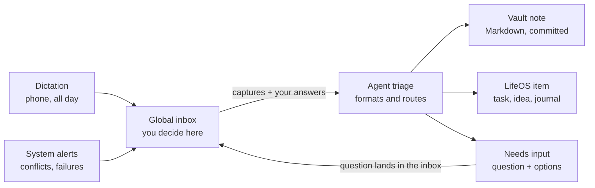

# Notes System Plan: Paperless, Sync, and a Frozen Notes Spec

Nov 12, 2026 · Chris Delaney

## Linking Paperless to LifeOS

Paperless can link into LifeOS through its REST API, which covers documents, tags, custom fields, full-text search, and uploads. The principle: Paperless owns the files and OCR, LifeOS owns the meaning and relationships, and links connect them. Don't copy documents into LifeOS.

Three levels of integration, simplest first:

1. **Reference by ID.** LifeOS stores a link like `paperless:1234` on any goal, project, or journal entry. The Journal service's polymorphic subject references already support this: a Paperless document is one more subject type. LifeOS fetches title, thumbnail, and preview on demand.
2. **Expose search to the agent.** Add a LifeOS MCP tool that wraps Paperless search, such as `find_documents(query, tags, date_range)`. The same agent that knows your projects can then answer "find the dishwasher warranty." Biggest payoff for the least work.
3. **Push events into LifeOS.** Recent Paperless-ngx versions have workflows that trigger on new documents, including webhook actions. A new scan lands in the LifeOS inbox for triage ("looks like a tax document; attach to 2026 taxes?"). Optionally write the LifeOS ID back into a Paperless custom field so the link exists in both places.

## Syncthing vs. OneDrive

For a Markdown vault that LifeOS indexes, Syncthing fits better, and Git should sit alongside it for history.

|  | Syncthing | OneDrive |
| --- | --- | --- |
| LifeOS ingestion | Server sees a real local folder; ingestion is file watching | Needs Graph API, or fights Files On-Demand placeholders |
| Android | True two-way sync of any folder | No arbitrary two-way folder sync without a third-party helper |
| Availability | Needs devices online together, unless one is always on | Cloud copy always available |
| Web access | None | Yes |
| Version history | Configure it yourself | Built in |
| Privacy | No cloud copy, no account, no quotas | Stored with Microsoft |

**Recommended setup:** Syncthing for device sync, an always-on machine as the hub, and a Git repo for history. AI writes become commits you can diff and revert, which gives provenance and auditability for free.

**Update (2026-11-12): stay on Obsidian Sync.** The vault (`C:\Users\csdel\Vaults\Chris2.0`) already syncs between PICARD and Jupiter (Chris's laptop) with Obsidian Sync, which works on Android and keeps version history. Moving to Syncthing would add work without fixing a problem. Git still sits alongside, on PICARD only; Obsidian Sync skips dot-folders, so `.git` stays local. PICARD is the hub: agents work on its copy of the vault.

## The fix: decide once, freeze it, enforce it with tooling

The resistance to Obsidian is option paralysis, not the tool. The answer is a written spec that makes the decisions once, plus automation that enforces it, so the knobs stop being your problem.

### 1. Write a one-page Notes Spec and freeze it

- **Note types, 5 max:** reference, knowledge, source, decision, project-note
- **Frontmatter:** one schema per type, required fields only
- **Folders:** flat — `inbox/` plus one folder per type
- **Linking:** wiki-links in the body, plus a `related:` field for LifeOS IDs
- **Tags:** a small controlled list
- **Freeze rule:** no spec changes for 90 days; changes only at a quarterly review, recorded in a changelog

### 2. Let AI do the formatting

Capture messily by voice, paste, or quick text. An agent with the spec loaded applies the template, frontmatter, summary, and suggested links, then files the note. You review and approve. This gets Obsidian's polished end state without the friction. Package the spec as a Claude skill so every Claude surface produces conforming notes.

### 3. Enforce the spec deterministically

A small validator checks each note's frontmatter against a JSON Schema for its type. LifeOS ingestion routes non-conforming notes to a "needs fixing" queue instead of accepting them silently. This is the process enforcement Obsidian lacks, and it follows the "deterministic before probabilistic" principle.

### 4. Treat the editor as a locked-down window

- **Option A:** keep Obsidian for its rendering, with a near-zero plugin rule in the spec and its config committed to Git so drift is visible.
- **Option B:** switch to a deliberately opinionated editor with few settings, such as iA Writer or Typora (verify current Windows and Android support).

Either way, the editor only reads and makes light edits. Structure comes from the spec and the agent, so the editor can be swapped later without changing the vault.

## Dictation pipeline and global inbox

Dictate all day; an agent files each capture, and anything needing a decision comes back through one place. The global inbox holds everything that needs your input or decision, from any source.

Clear captures are filed without you; anything uncertain, and any system problem, returns to the inbox as a question.

### Pipeline rules

- **Keep the raw transcript.** Store it untouched and link each formatted note back to it.
- **Confidence threshold.** Clear items are filed automatically; ambiguous ones become "needs input" items.
- **Route by kind.** Tasks and ideas go to LifeOS state objects. Reflections and journal entries, reference, knowledge, sources and project notes go to the vault ([Notes Spec](notes-spec.md) §1; changed 2026-11-12, when reflections moved to the vault).
- **Create, don't rewrite.** The agent adds new notes and appended sections; restructuring hand-edited notes needs review.
- **Daily digest.** A short "here's what I filed today" summary for spot-checking.

### Git on the hub

- The agent commits once per processed item, with the inbox item ID in the message.
- A scheduled script commits manual edits from phone and desktop.
- The repo lives only on the hub; add `.git` to `.stignore` so devices never see it.
- No force-pushes or history rewrites; push to an offsite remote as backup.

### Global inbox design

- **Answerable in one step.** Each item carries the question, linked context, two to four options, and the agent's recommendation. Your answer flows back to the agent that asked.
- **Blocking vs. non-blocking.** Low-stakes questions proceed with the recommended default after a timeout, and the inbox records that it did.
- **Noise control.** Dedupe repeated questions, batch non-urgent items into a daily review, and give items priority and expiry.
- **System problems as items.** A hub script turns `.sync-conflict` files, failed spec validations, and failed Git pushes into inbox items.
- **Provenance.** Each item records its source, why it was created, and what happened after you answered.

### Minimal first version

1. Dictate into the inbox.
2. The agent files clear notes into the vault and commits them.
3. Anything uncertain returns to the inbox as a "needs input" item.

Live with that for a few weeks before designing the rest.

## Decisions (Chris)

- **2026-11-12: reflections live in the vault (option A).** Chris dictates his daily reflections; an agent summarizes and formats each into a vault note in the Notes Spec's format, and the LifeOS review links to it. This replaces SuperJournal as the home of review answers ([reviews plan](pilot/reviews-plan.md) §4). He still uses SuperJournal for other things.
- **2026-11-12: the notes system comes before the rest of the roadmap's daily command center** (TODAY-1, TODAY-2, monthly reviews), because it also gives reviews their answers.
- **2026-11-12: one of the first jobs after the spec is a complete cleanup of the vault,** done by an agent, so the vault is standardised as a baseline before the pipeline starts writing into it (N3).
- **2026-11-12, Chris's answers on the draft spec:**
  - **Folders by type,** and today's folders retired as their notes move. "This is especially not needed if my AI agents will organize and link stuff for me." Claude's reorganization suggestions stand.
  - **Zero task objects in the vault.** "Most tasks I figure will be deleted out of Obsidian."
  - **Large videos in a standard OneDrive place, linked from notes.** He'll have many more. Adding one mustn't need hand-linking (spec §5).
  - **Generated maps (MoC):** for instance one for all the daily, weekly and monthly reflections with past months and years folded, per note type or as he defines them, plus a central dashboard to drill down from, all managed by agents (spec §6).
  - **The spec is frozen only after he has seen the reorganized vault,** so the first version is reached by iterating (N3).
- **2026-11-12: source and knowledge stay separate** (spec v0.4). A note about one outside work is a source, even in Chris's own words.
- **2026-11-12: agents link related notes, option B** (spec v0.5 §4). "I shouldn't have to explicitly define every way to link things myself." Links go in when a note is filed and in a nightly sweep that adds them to older notes, and the existing notes get a backfill. Chris accepted the recommended details: a Related section at the end of the note, and no approval step.
- **2026-11-12: the reorganized copy is approved** ("Vault re-org approved"), as round 1 left it, with its follow-ups through spec v0.7: sources, related links and hidden markers. The round's proposals in the spec's Still open list are accepted with it. Next is N4. Before the cutover, these need Chris:
  - the plugin keep-and-remove list (spec Still open 1);
  - Blue Skies' LifeOS Area (Still open 5);
  - a LifeOS item for each of the 4 projects the validator fails;
  - the 3 secrets moved to his password manager, with the webhook and key rotated;
  - a moment when the other devices can take the synced reorganization.
- **2026-11-12: Chris's answers for the cutover (N4).**
  - **Plugins:** keep Dataview, Style Settings and the cosmetic ones: Rainbow-Colored Sidebar, Colored Text, Emoji Toolbar and Multi-Column Markdown, whose layout two 2025 reflections use. Remove Tasks, Kanban, Full Calendar, Big Calendar, Make.md, Iconize, Templater, Thumbnails, Columns, MetaEdit and Local REST API. Removing is reversible: each plugin's folder moves out of the vault, nothing is deleted.
  - **Blue Skies** belongs to the Trader Area, every note of it.
  - **The 4 projects with no LifeOS item:** Chris creates a LifeOS Project for each before the cutover, and the agent links them.
- **2026-11-12: stricter related links (spec v0.6).** The first backfill linked by topic and made the graph "a big web where everything is related to everything else". Chris accepted the recommendation as it stood: each link names its kind (part of, continues, answers, same thing), at most two per note, one direction, and the graph hides the maps, Home and tags.

## The vault today (surveyed 2026-11-12)

- 172 notes, about 56,000 words, and 4.6 GB, of which about 3.6 GB is course videos.
- Folders mix two numbering schemes (`00 - Inbox`, `10 - Projects`, `200-Areas`, `300-Resources`, `98 - Attachments`), clippings sit in two places, and `Tags/` and `10 - Projects/Untitled/` are empty. The vault's own `CLAUDE.md` describes folder names that no longer match.
- 93 notes have no front matter, 42 have fewer than 15 words, and 35 link targets don't resolve.
- 67 daily logs in `300-Resources/Journals/`, with a routine checklist (now LifeOS habits) and a sober-streak field (now the Food Log's).
- 154 open checkboxes, mostly in project notes, behind a Tasks-plugin dashboard.
- 13 community plugins. Make.md leaves `.mdc`, `.mdb` and `.space` files; `.obsidian` holds about 80 `workspace-<device>-N.json` files.
- Not under Git. The vault's `CLAUDE.md` already defines APPEND-ONLY and DIRECT-MODIFY modes for agents, which the spec keeps.

## Phases

| Phase | What | Done when |
|---|---|---|
| **N0** | This plan | Committed |
| **N1** | The [Notes Spec](notes-spec.md): drafted, then revised in each N3 round | Frozen in N4 |
| **N2** | Baseline: a full snapshot of the live vault, and a working copy to reorganize (below) | The copy opens in Obsidian as its own vault, with Sync off |
| **N3** | The reorganization, on the copy, in rounds (below): the manifest and the script that applies it, the map generator and `Home.md`, the validator. Chris browses each round in Obsidian; the spec changes with his feedback | Chris is happy with the reorganized copy |
| **N4** | Freeze and cut over: the spec frozen and moved into the vault, the manifest re-run on the live vault, Git started there, the videos moved to `Vault Media`, the dropped plugins removed | The live vault matches the copy and the validator passes |
| **N5** | The formatter skill (the spec packaged so every Claude surface writes conforming notes), the media sweep and the nightly related-links sweep (spec §4) | A dictated sample becomes a valid note of each type with its related links, older notes it fits link to it the next night, and a dropped video gets its note |
| **N6** | The minimal dictation pipeline: dictate, the agent files clear notes and commits, anything unclear comes back as a needs-input item | A week of real use |
| **N7** | LifeOS agent writes at the `capture` level (agent-access plan Phase 2), so the agent can mark a capture handled, file Tasks and Ideas, and link a reflection to its review | The agent-access plan's Phase 2 tests |
| **N8** | Reviews R5: the review links to its reflection note, and the page shows its summary and an "Open in Obsidian" link | A daily and a weekly review answered by dictation |
| **N9** | Paperless search in `/mcp` | An agent finds a document by asking |

N2 to N4 need nothing from LifeOS. N6 can start before N7 by filing only into the vault.

### N2 and N3: reorganizing a copy

An agent in a Claude Code session on PICARD. Chris keeps using the live vault as usual the whole time.

**The copy:**

1. A full snapshot of the live vault first: a zip in `C:\Users\csdel\Vaults\_snapshots\`, checked by opening it.
2. The working copy is `C:\Users\csdel\Vaults\Chris2.0 reorg`, without the large videos (they're only linked).
3. **Obsidian Sync must stay off in the copy,** or the reorganization could sync into the live vault and every device. Before the copy is first opened, the `sync` core plugin is switched off in its `.obsidian/core-plugins.json`, and Chris doesn't connect it to a remote vault.
4. Git starts in the copy, with a first commit of it as found, so every round is a diff Chris can read and undo.

**What a round does:**

1. **A manifest:** every note with its type, new folder and name, front matter changes, merges and archivals, as a file the apply script reads. The agent's uncertain calls are marked in it.
2. **An apply script** that turns the copy into the reorganized vault from the manifest, rewriting every link to a moved note. Reorganizing by script, not by hand, is what lets N4 re-run it on the live vault, which has moved on in the meantime.
3. **Reflections:** the 67 daily logs become `reflection` notes, `kind: daily`, with their writing untouched; the routine checklists and sober-streak fields go, since LifeOS keeps both.
4. **Tasks:** checkboxes are removed. Git keeps the old text, and a list in `99 System/` shows what was removed from each note, so Chris can carry any he wants into LifeOS.
5. **Projects** are linked to their LifeOS items by URN, and the ones with no match are listed.
6. **Maps and `Home.md`** generated from the starting definitions (spec §6).
7. **The validator** runs, and the unresolved links are fixed or listed.
8. **Nothing is deleted.** Notes leave through `98 Archive/`.
9. Chris opens the copy in Obsidian ("Open folder as vault") and says what to change. The spec and the manifest change, and the next round starts from the snapshot again.

The tools (apply script, map generator, validator) are Python, kept in the vault under `99 System/tools/`, so they're versioned with it.

### Round 1 (2026-11-12)

- **Snapshot:** `C:\Users\csdel\Vaults\_snapshots\Chris2.0 2026-11-12 1014.zip` (628 files, 4.84 GB, every member read back), with an inventory of each file's size, date and CRC beside it. `snapshot.py compare` against it showed the live vault unchanged after the round.
- **The copy** left out 14 videos (4.8 GB); `99 System/Media to move.md` lists each with its `Vault Media` path. Sync is off in its `core-plugins.json`. Git: `0c9e876` is the vault as found, `d7957da` the round.
- **Result:** 169 notes moved to the type folders (54 of them to `98 Archive`), 331 checkboxes taken out, 22 links rewritten, the maps and `Home.md` generated. The validator fails only the 4 projects with no LifeOS item, and warns about 3 notes holding secrets (by location in the round report) and 5 links to notes that were never written.
- **Checklists (CHECKLIST-1):** no note was a checklist on its own. Oral Care, with its numbered routine, is tagged `checklist` and is the one note on the Checklists map; the weekly planning and pre-open checklists inside 2025 reflections wait on Chris saying he still uses them.
- **Sources and knowledge (spec v0.4):** Chris kept both and drew the line at "about one outside work". His notes on Tom Bilyeu's courses and the Wisey ADHD course, Ketogenic Expert reset and Procrastination moved to `50 Sources`, which leaves 4 knowledge notes and 28 sources.
- **Related links (spec v0.5, then v0.6):** the first backfill put 204 links in 81 notes, linked by topic. Chris's graph became a web where everything linked to everything. Under v0.6's strict rules (four kinds of link, at most two per note, one direction, series to their hub), one agent redid it: 54 links in 47 notes. The graph view now also hides the maps, Home, tags, the archive and `99 System`, which drew it into one web. The links live in `99 System/reorg/related.yaml`, the whole set, and `notes_tools.related` writes them after the apply, keeping file dates. Before the N5 sweep does the same on the live vault, check that Obsidian Sync carries a change whose file date was kept.
- **Follow-ups within the round** (the checklist tag, the sources move) are applied the same way: change the calls, rebuild the manifest and apply it in a throwaway as-found worktree at a short path, check that only the expected notes differ from the copy, and copy those notes in with a change log for the change. This keeps Chris's own edits in the copy.
- **The manifest** is written by `99 System/reorg/build_manifest.py`, which holds every call, the summaries an agent wrote for the daily reflections, and the routine-checklist items. Change the calls there, not in the YAML.
- **A new round** starts from the as-found commit; `99 System/tools/README.md` has the steps. Git writes every file with today's date, so `snapshot.py restore-times` puts the dates back before the apply.
- **The one write to the live vault,** at Chris's request: heading sizes 28, 24, 22 and 20 px in `.obsidian/snippets/colors.css`, the same file as the copy's. `snapshot.py compare` lists it as changed, along with the settings and Make.md caches Obsidian rewrites as he uses the vault.
- **Edits Chris makes in the copy** are lost when a new round resets it to the as-found commit, so each round first commits them and carries any he wants to keep into the live vault or the manifest.
- **For N4:** the copy's Git history holds the 3 secrets, so it stays on PICARD, and they come out of the live notes before Git starts there. Plugin settings that name old folders (Iconize, Make.md) were left as they are.

### N4: the cutover

**Prepared 2026-11-12.** A rehearsal ran the whole cutover below on a fresh copy of the live vault (snapshot `Chris2.0 2026-11-12 1321.zip`), with its 14 videos in place and a stand-in folder for `Vault Media`, and compared the result with the approved copy. Notes, folders, front matter, links, maps and settings came out the same. What differed was meant: the Blue Skies Area (since copied into the copy), the removed plugins, the stand-in video paths, and blank lines at the end of notes whose Related section came and went in the first backfill. The rehearsal found two gaps, both closed: Git's line-ending settings must be set before the first commit, and the graph filter and marker snippet, set by hand in the copy, are now in the manifest. `media plan` run on the live vault itself lists the same 14 files as the copy.

The tools for it are in the copy's `99 System/tools/`: `media` (plan, move, restore), `plugins` (list, remove, restore) and `validate --secrets`. The vault's new `CLAUDE.md` is drafted in the copy.

**Before the day, Chris:**

1. Moves the three secrets into his password manager and deletes them from the notes: the database password in Blue Skies' Tech Stack, the two Discord lines in Discord Bot Poster, and the key in LifeOS Pilot Punchlist. Then rotates the webhook and the key. Git keeps whatever its first commit holds, so `validate --secrets` must find nothing before it.
2. Creates a LifeOS Project for each of Clean the House, Front lawn Sprinkler system, Full 2026 Budget, and Inbox to Zero and Sustaining, and re-authorizes the LifeOS connector (`/mcp`) so the agent can read their URNs.
3. Picks a time. Just before it, on each device (PICARD, Jupiter): opens Obsidian, lets Sync finish, and closes it. Nothing may change the vault until step 9.

**The cutover,** by an agent on PICARD with Chris at hand. `LIVE` is `C:\Users\csdel\Vaults\Chris2.0`; `HOLD` is `C:\Users\csdel\Vaults\_cutover\<date>`, outside the vault so Sync never sees it. Until step 3 copies the tools in, they run from the copy's `99 System/tools` with `uv run python -X utf8 -m notes_tools.<tool>`.

1. **Snapshot and rehearse.** `snapshot take --vault LIVE --out C:\Users\csdel\Vaults\_snapshots`. Make a copy of that snapshot at a short path (`make_copy`, which leaves the videos out) and run `build_manifest.py` on it. It stops on any note it has no call for: notes written since 2026-11-12 need a call in the copy's `build_manifest.py`, as do the 4 projects' new URNs. Repeat until it passes, then run the apply, `related`, `maps` and `validate` there too; only the 5 links to notes never written may warn.
2. **Git.** In LIVE: `git init`, then `git config` `core.autocrlf false`, `core.safecrlf false`, `core.quotepath false` and `core.longpaths true`, so Git never rewrites a note's line endings. Copy the copy's `.gitignore`. `validate --vault LIVE --secrets` must say 0. Then `git add -A` and commit the vault as found.
3. **Tools in.** Copy in what the tools README's "A new round" step 1 lists, with `.obsidian/snippets/hide-comments.css`, and commit. From here the tools run from `LIVE\99 System\tools`.
4. **Videos.** `media plan --vault ../..` (14 files; it names any file over 20 MB that isn't a video, which `.gitignore` wouldn't cover), commit. `media move --vault ../.. --hold HOLD\media`, first with `--dry-run`. It copies each file to OneDrive, checks size and SHA-256, and only then moves the original into HOLD. Commit the list it updates.
5. **Reorganize.** `build_manifest.py --vault ../..`, commit. Then `apply`, `related`, `maps` and `validate`, which should fail nothing now, and commit.
6. **Plugins.** `plugins remove --vault ../.. --hold HOLD\plugins obsidian-tasks-plugin obsidian-kanban obsidian-full-calendar big-calendar make-md obsidian-icon-folder templater-obsidian obsidian-thumbnails obsidian-columns metaedit obsidian-local-rest-api`. `plugins list` then shows the 6 kept. Commit.
7. **The spec frozen.** Version 1.0: the Still open items folded into their sections, the plugin list in it. Copy it to `99 System/Notes Spec.md` and the drafted `CLAUDE.md` over the vault's, and commit. LifeOS's `docs/notes-spec.md` becomes a pointer to it.
8. **Check before syncing.** Nothing has left PICARD yet. If anything looks wrong, the snapshot from step 1 is a complete undo (videos included), and `media restore` and `plugins restore` put back what they moved.
9. **Sync.** Open Obsidian on PICARD. Check Settings → Sync is still connected to the remote vault, and whether it syncs installed plugins (if not, each device keeps its own until removed there). Let it upload. Then `git status` must show only Obsidian's own settings: a note back at an old path means Sync restored it, so stop and look. Check Home, a video playing from OneDrive, the graph, and that the Related markers are hidden.
10. **The other devices,** one at a time: open Obsidian and let it sync.
11. **Later, Chris** deletes HOLD once he's happy (the videos are in OneDrive) and decides what happens to the copy, whose Git history holds the old secrets.

**Cut over on PICARD, 2026-11-12, 13:53 to 13:59,** after Chris had done his three steps, except a Project for Clean the House, which he'll add later. Steps 1 to 8 ran as written:

- **Snapshot** `Chris2.0 2026-11-12 1353.zip`, identical to the rehearsal's of 13:51.
- **Git** in the live vault: `910c6e0` is the vault as found, `151e291` the spec and `CLAUDE.md`. In between: the tools, the media list, the videos moved, the manifest, the reorganization (`aea69d7`) and the plugins.
- **HOLD** is `C:\Users\csdel\Vaults\_cutover\2026-11-12\`: `media\` has the 13 video originals, `plugins\` the 11 plugins with Make.md's caches and Iconize's icons.
- **The validator** fails only Clean the House, and warns about the 5 links to notes never written.
- **Found and fixed on the way:**
  - The media dry run removed empty folders, which it mustn't. It removed the empty `10 - Projects/Untitled`, which the apply would have removed anyway.
  - The empty `Tags` folder has Windows' read-only mark, which blocks removing it. The tools now clear the mark.
  - Chris's removal of the secrets moved three notes' file dates, which the manifest uses when a note has no `created`. Tech Stack, Discord Bot Poster and LifeOS Pilot Punchlist keep their dates as found (`CREATED` in `build_manifest.py`).
- **Step 9, the first sync, 14:02.** Sync stayed connected and no note came back at an old path, but Jupiter was still open with the old plugins. The reorganization reached it as new files, so Templater filled in the five archived templates (Another template example renamed itself to `2026-11-12 - Daily Note`), and Iconize dropped its icons for the old paths and uploaded its settings, which brought back `.obsidian/plugins/obsidian-icon-folder/data.json` (so PICARD's Sync does sync installed plugins). Committed as found (`57df40a`); the originals are in Git. `validate --secrets` crashed on the renamed template, which Git still listed; fixed (`7270519`).
- **Step 10.** Jupiter restarted with only the kept plugins and synced; it changed nothing on PICARD. Obsidian runs on PICARD and Jupiter only: the Mercury and Venus this plan first named came from old workspace files in the vault. With Templater gone everywhere, the five templates are back as found, text and file dates (`1f1279e`), and Iconize's synced `data.json` is in `HOLD\after-first-sync\`.
- **Clean the House,** 14:26. Chris chose to delete its two notes instead of making a Project for them (vault `d53d279`, with a change log; Git and the snapshot keep them). The validator now fails no note, so N4 is done.
- **Left:** step 11, Chris's, whenever he's ready.

### N5: the formatter skill and the nightly sweep

Designed 2026-11-12, when Chris said to start N5. Everything runs on PICARD, where the vault's Git is, and is built in the vault's `99 System/` with tests, in this order:

1. **Links Chris deletes stay deleted** (spec §4). **Done** (vault `163f095`). `related` wrote every note's Related section from `related.yaml`, so a link Chris deleted in Obsidian would have come back at the next run. Now the notes hold their links: `related --add` puts each new link at the end of its note's section and logs it in `99 System/related-log.yaml` (seeded with round 1's 52 links). A logged link that's gone from its note is one Chris deleted, and `--add` refuses it. The whole-set rewrite from `related.yaml` refuses on the live vault.
2. **The media sweep** (spec §5), `media sweep`. **Done** (vault `eda4faf`); on the live vault it finds nothing to do. It moves any video or file over 20 MB out of the vault into `Vault Media\<year>\` (copy, check SHA-256, then remove the vault's copy), and rewrites every embed or link to it the §5 way. It also lists the files in `Vault Media` that no note links. It's deterministic; the agent writes a `source` note for each listed file, or asks.
3. **The formatter skill,** `notes-formatter`, kept in the vault at `99 System/skills/notes-formatter/`. **Done** (vault `472693c`, revised in `3d0df02` and `9a6c5a2`). Installed on PICARD 2026-11-12: a junction, `%USERPROFILE%\.claude\skills\notes-formatter`, points at the vault's folder, so every Claude Code session there has it and an edit in the vault reaches them all. Raw words go in `95 Transcripts` as `.txt` (a `.md` there would need front matter), and only reflections carry `transcript`, since the frozen schemas allow no other fields. It is the spec as a procedure: decide the type (§1), name the note (§3), write the front matter its schema asks for and the body (a reflection's four sections), keep the raw words in `95 Transcripts` and point `transcript` at them, add up to two Related links with `related --add`, then validate, rebuild the maps, write the change log and commit. When unsure, it files nothing: it leaves a question note in `00 Inbox`, where Home lists it, until N7 gives agents LifeOS's inbox. For the phone and claude.ai, `skills build` zips it with the spec, schemas and templates for Chris to upload himself; there it writes the note's text, since it can't reach the vault. Not built yet.
4. **The nightly sweep,** the Claude desktop scheduled task `vault-nightly-sweep` on PICARD. **Created 2026-11-12** with Chris's approval: daily at 3:00 AM (the app adds a few minutes, so about 3:09), saved in Bypass permissions mode so it runs without asking, and run only while the Claude app is open (or at its next launch). It commits Chris's own edits since the last run, runs `media sweep`, writes notes for unlinked media, and for each note added since the last sweep adds its links and the lines older notes should get (§4's rules, through `related --add`). Then `maps` and `validate`, one commit named `Nightly sweep <date>: ...` and a change log. It changes nothing outside Related sections and the notes it writes, and never pushes (the vault has no remote). It skips a night that already has a `Nightly sweep <date>` commit. Its prompt is in the vault, `99 System/tools/nightly-sweep-task.md`, so it changes under Git; after an edit there, update the task with the new text. An empty commit, `Nightly sweep 2026-11-12: baseline` (vault `9ce8cc5`), marks where the first sweep starts.
5. **The check** (the phase's "done when"). **Done 2026-11-12,** by two fresh agents given only the skill, on a copy of the vault (snapshot `1439`) with a stand-in `Vault Media`. Nine test captures became a daily and a weekly reflection, two knowledge notes, a checklist, a source, an addition to the sprinkler project's note, and three inbox questions (a workshop with no LifeOS Project, two errands for LifeOS, a camera-named video), each valid, with its transcript and links. The sweep linked an older chapter note to its book's new note, and wrote a source note, linked to its course, for a video dropped into `Vault Media`. Each run's gaps went back into the skill (vault `3d0df02`, `9a6c5a2`). Not covered: a brand-new project note, since the LifeOS connector wasn't signed in, and the task itself running at night. N5 is ticked once the first night's run (2026-11-13) has been read and its commit checked.

Decided rather than asked, since one option wins: a desktop scheduled task, not Task Scheduler with `claude -p` (which can bill the API) or a cloud routine (which can't reach the vault); and questions waiting in `00 Inbox` until N7.

## Status

- [x] N0 — This plan
- [x] N1 — Notes Spec (frozen at v1.0 on 2026-11-12; it lives in the vault as `99 System/Notes Spec.md`)
- [x] N2 — Snapshot and a working copy (2026-11-12; Chris opened the copy in Obsidian the same day)
- [x] N3 — Reorganize the copy, in rounds (round 1 and its follow-ups, approved by Chris 2026-11-12 at spec v0.7)
- [x] N4 — Freeze the spec and cut over (2026-11-12, synced to PICARD and Jupiter; Chris deletes HOLD when he's ready)
- [ ] N5 — Formatter skill, media sweep and related-links sweep (all built and installed 2026-11-12; waiting on the first nightly run)
- [ ] N6 — Minimal dictation pipeline
- [ ] N7 — LifeOS agent writes at `capture`
- [ ] N8 — Reviews R5: reflections linked to reviews
- [ ] N9 — Paperless search in `/mcp`

## Later

- **Videos that play on the phone.** The `file:///` embeds play only on PCs that sync OneDrive. OneDrive share links, made by the agent through Microsoft Graph, would play anywhere.
